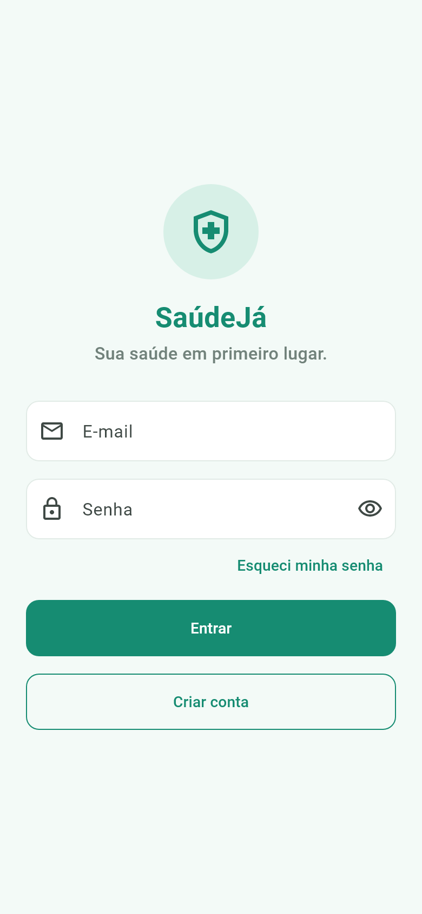
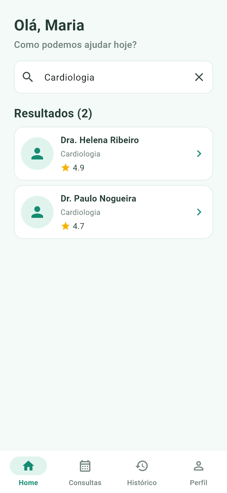
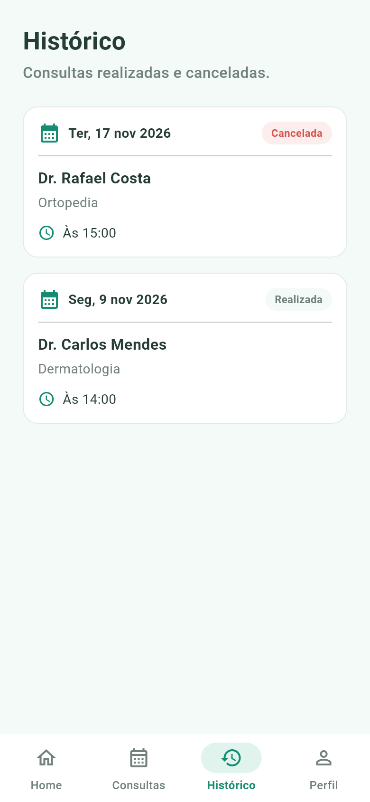
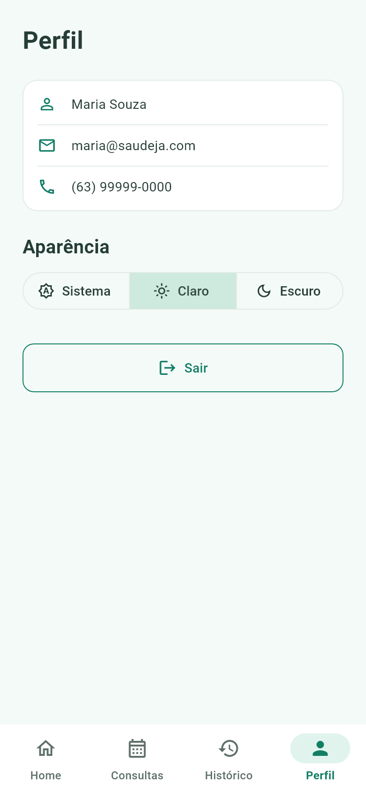
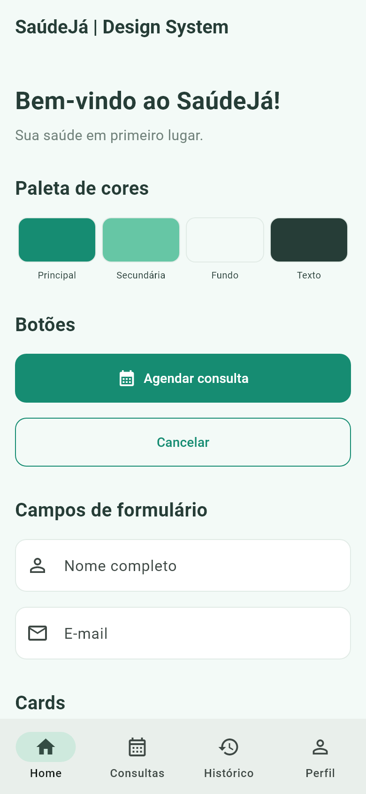

# SaúdeJá

[](https://github.com/GUIZINLT/saude_ja/actions/workflows/ci.yml)


Aplicativo Flutter de **agendamento de consultas médicas**. O paciente cria a conta, encontra médicos por nome ou especialidade, escolhe data e horário, acompanha as consultas e pode cancelá-las.

O projeto tem **design system próprio** (tokens, componentes e Sample App), **arquitetura MVVM** com `provider` e um **mock do backend** que segue a [documentação da API](docs/API.md). Assim, todas as telas funcionam sem servidor.

## Telas

| Login | Cadastro | Home |
|:---:|:---:|:---:|
|  |  |  |
| **Busca por especialidade** | **Agendamento** | **Consultas** |
|  |  |  |
| **Histórico** | **Perfil** | **Sample App do design system** |
|  |  |  |

## Funcionalidades

- **Login e cadastro**, com validação dos campos e mensagens de erro da API (e-mail já cadastrado, senha incorreta).
- **Home**: saudação, busca de médico ou especialidade, especialidades, próxima consulta e médicos em destaque.
- **Agendamento**: próximos dias de atendimento do médico e horários livres, ocupados ou bloqueados. Se o horário for ocupado antes da confirmação, a grade se atualiza.
- **Consultas**: consultas confirmadas, com cancelamento após confirmação.
- **Histórico**: consultas realizadas e canceladas.
- **Perfil**: dados do paciente e saída da conta.
- **Sessão salva**: ao reabrir o app (ou recarregar a página na web), o paciente continua logado.
- **Ícone e tela de abertura** próprios, gerados a partir do design system.
- Roda em **Android, iOS e web**.

## Arquitetura (MVVM)

```
View (tela)  ──lê estado / chama ações──▶  ViewModel (ChangeNotifier)
                                                │
                                                ▼
                                           Repository
                                                │
                                                ▼
                                ApiService (interface)
                                                │
                                   ┌────────────┴────────────┐
                                   ▼                         ▼
                           MockApiService              (backend real,
                           lê assets/mock/*.json        mesma interface)
```

- **Views** só desenham e repassam ações; não validam nem chamam a API.
- **ViewModels** guardam o estado da tela (carregando, erro, dados) e as regras de apresentação.
- **Repositories** reúnem as chamadas por assunto (autenticação, catálogo, consultas).
- **ApiService** é o contrato da API. Hoje quem o implementa é o `MockApiService`; para usar um backend real, basta criar outra implementação e trocar uma linha no `main.dart`.

```
lib/
├── core/              rotas, tema, validações e formatação de datas
├── data/
│   ├── models/        User, Doctor, Specialty, Appointment, ...
│   ├── repositories/  AuthRepository, CatalogRepository, AppointmentRepository
│   └── services/      ApiService (interface), MockApiService e MockBackend
├── design_system/
│   ├── tokens/        AppColors, AppTypography, AppSpacing
│   ├── components/    componentes reutilizáveis (lista abaixo)
│   └── sample_app/    vitrine dos componentes
├── features/
│   ├── auth/          Login e Cadastro
│   ├── home/          Home e menu inferior
│   ├── appointments/  Agendamento e Consultas
│   ├── history/       Histórico
│   └── profile/       Perfil
├── main.dart                 app
└── main_design_system.dart   abre direto o Sample App
```

## Design system

Cores, tipografia, espaçamentos e arredondamentos ficam centralizados em `lib/design_system/tokens/` (`AppColors`, `AppTypography`, `AppSpacing` e `AppRadius`). Os componentes não usam valores soltos: toda cor, tamanho de fonte, espaço e canto vem de um token.

| Componente | Uso |
|---|---|
| `AppButton` | Botão principal e secundário, com estado de carregando |
| `AppTextField` | Campo de formulário com ícone, erro e ação no fim |
| `AppCard` | Card base |
| `SpecialtyCard` | Especialidade com ícone |
| `DoctorCard` | Médico com especialidade e nota |
| `AppointmentCard` | Consulta com data, status e ação opcional |
| `DateChip` | Dia no seletor de datas |
| `TimeSlotButton` | Horário livre, ocupado ou escolhido |
| `AppDialog` | Aviso e confirmação (inclusive de ação destrutiva) |
| `AppBottomNavigation` | Menu inferior |

O **Sample App** (`flutter run -t lib/main_design_system.dart`) mostra os tokens e todos os componentes, cada um nos seus estados. Dá para escolher dia e horário e abrir os diálogos.

<details>
<summary>Ver o Sample App inteiro</summary>


</details>

## API e mock do backend

- A documentação completa, com rotas, requests, responses e códigos de status, está em **[docs/API.md](docs/API.md)**.
- Os dados iniciais ficam em `assets/mock/*.json`. Agendar e cancelar funcionam durante o uso, e tudo volta ao estado inicial quando o app reinicia.
- O mesmo mock pode rodar como **servidor HTTP** (`http://localhost:8080`):

```powershell
dart run tool/mock_server.dart
```

**Usuário de teste:** `maria@saudeja.com` / `123456`

## Como rodar

Pré-requisito: Flutter (Dart 3.12 ou superior).

```powershell
flutter pub get
```

```powershell
flutter run
```

No navegador:

```powershell
flutter run -d chrome
```

Só o Sample App do design system:

```powershell
flutter run -t lib/main_design_system.dart
```

## Testes

```powershell
flutter analyze
```

```powershell
flutter test
```

São 65 testes: regras do mock, sessão salva, ViewModels (login, cadastro, Home, agendamento, consultas e histórico) e os fluxos completos nas telas.

A cada push, o **GitHub Actions** ([.github/workflows/ci.yml](.github/workflows/ci.yml)) confere formatação, análise estática, testes e o build web. O selo no topo deste README mostra o resultado.

Os prints deste README são gerados por teste, sempre com os mesmos dados e data. Para atualizar depois de mudar alguma tela:

```powershell
flutter test screenshots/screenshots_test.dart --update-goldens
```

O ícone e a tela de abertura também são gerados a partir do design system
(imagens em `assets/brand/`):

```powershell
flutter test screenshots/brand_assets_test.dart --update-goldens
```

```powershell
dart run flutter_launcher_icons
```

```powershell
dart run flutter_native_splash:create
```

## Tecnologias

- Flutter e Dart
- `provider` (ChangeNotifier) para MVVM
- `shared_preferences` para salvar a sessão
- `flutter_launcher_icons` e `flutter_native_splash` para ícone e tela de abertura
- GitHub Actions para integração contínua
- Material 3
