# SaúdeJá

[](https://github.com/GUIZINLT/saude_ja/actions/workflows/ci.yml)
[](LICENSE)


Aplicativo Flutter de **agendamento de consultas médicas**. O paciente cria a conta, encontra médicos por nome ou especialidade, escolhe data e horário, acompanha as consultas e pode remarcá-las ou cancelá-las.

O projeto tem **design system próprio** em pacote separado (tokens, temas claro e escuro, componentes e Sample App), **arquitetura MVVM** com `provider` e um **mock do backend** que segue a [documentação da API](docs/API.md). Assim, todas as telas funcionam sem servidor.

> **Entrega do trabalho:** o [guia de entrega](docs/ENTREGA.md) mostra onde está cada item pedido e um roteiro de apresentação.

## Protótipo

Antes do código, as telas principais foram prototipadas com a identidade visual do app (verde e branco, fonte Inter). Cada tela está em [`docs/prototipo/`](docs/prototipo) como HTML, que abre em qualquer navegador, e como imagem.

| Login | Cadastro | Home | Especialidades | Agendamento |
|:---:|:---:|:---:|:---:|:---:|
| 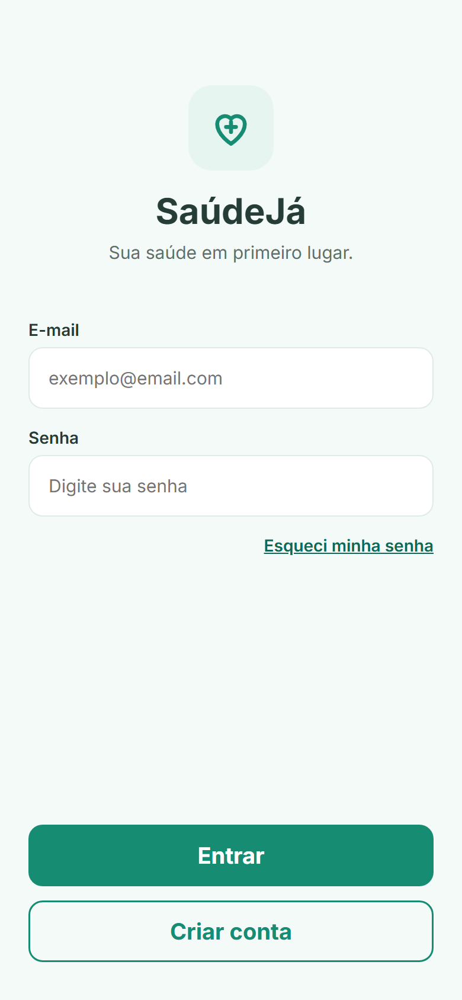 | 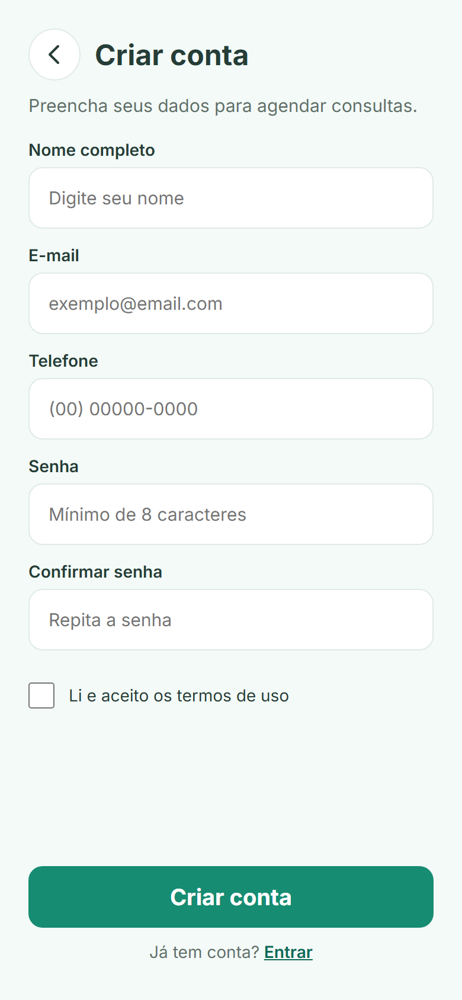 | 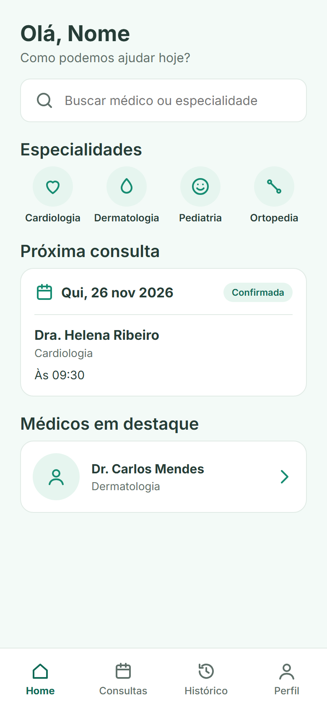 | 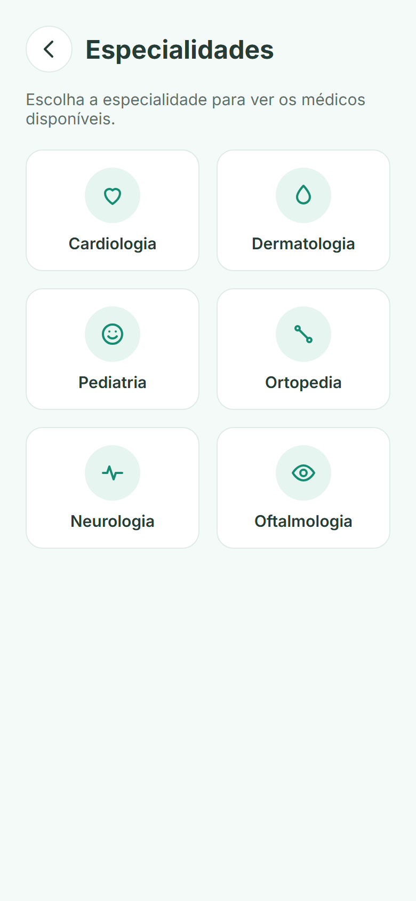 | 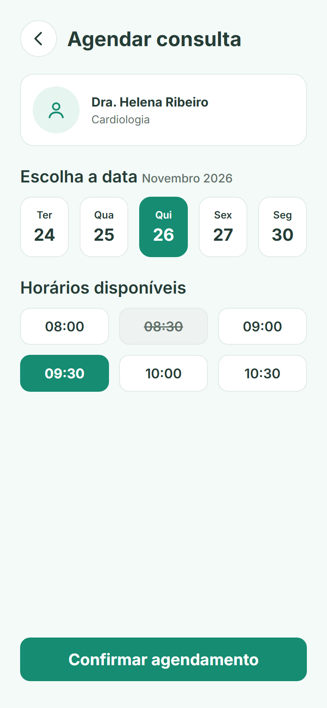 |

## Telas do app

| Login | Cadastro | Home |
|:---:|:---:|:---:|
|  | 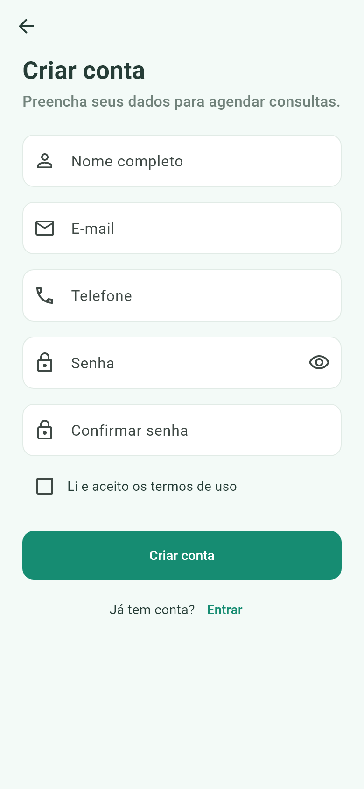 | 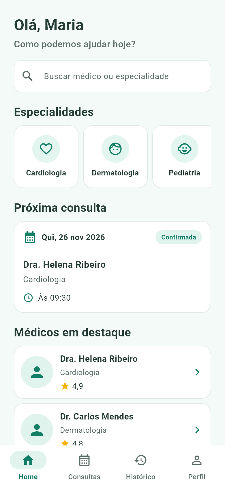 |
| **Busca por especialidade** | **Detalhes do médico** | **Agendamento** |
|  | 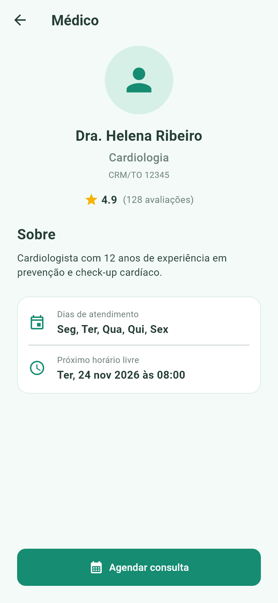 | 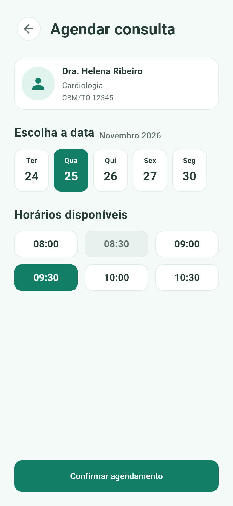 |
| **Consultas** | **Histórico** | **Perfil** |
| 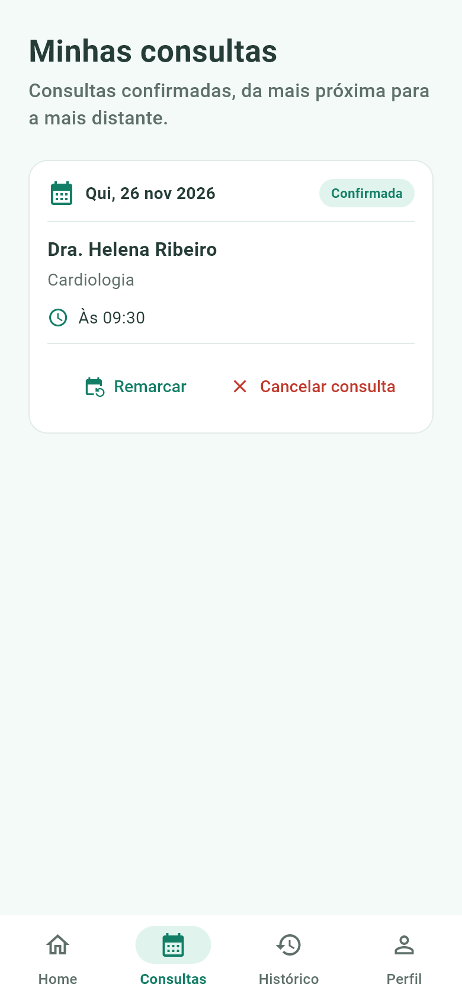 |  |  |
| **Esqueci minha senha** | **Home (tema escuro)** | **Agendamento (tema escuro)** |
| 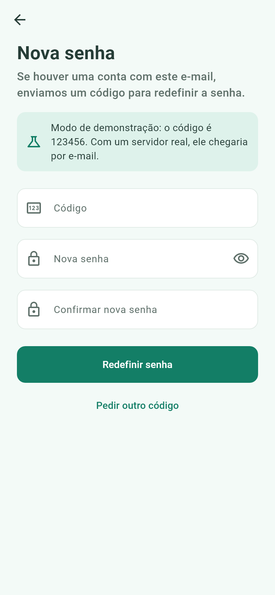 | 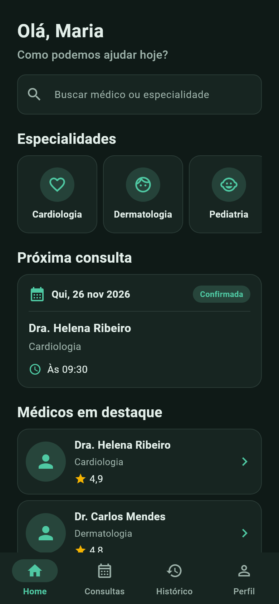 | 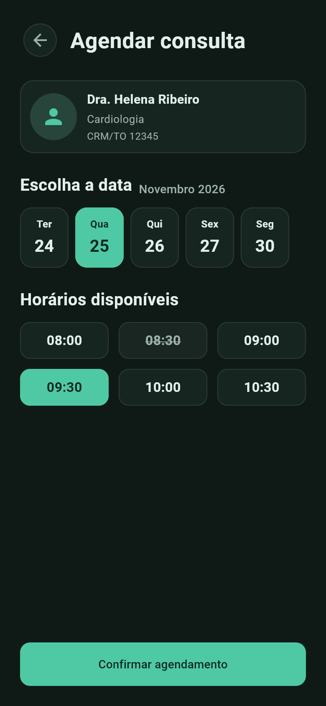 |

## Funcionalidades

- **Login e cadastro**, com validação dos campos, máscara de telefone e mensagens de erro da API (e-mail já cadastrado, senha incorreta).
- **Esqueci minha senha**: código de 6 dígitos (válido por 15 minutos e de uso único) para criar uma nova senha.
- **Home**: saudação, busca de médico ou especialidade, especialidades, próxima consulta e médicos em destaque.
- **Detalhes do médico**: CRM, nota, avaliações, dias de atendimento e próximo horário livre.
- **Agendamento**: próximos dias de atendimento do médico e horários livres, ocupados ou bloqueados. Se o horário for ocupado antes da confirmação, a grade se atualiza.
- **Consultas**: consultas confirmadas, com **remarcar** (troca data e horário numa operação só) e cancelar (após confirmação).
- **Histórico**: consultas realizadas e canceladas.
- **Perfil**: dados do paciente, escolha do tema e saída da conta.
- **Tema escuro**: segue o sistema ou é escolhido no Perfil (Sistema, Claro ou Escuro); a escolha fica salva.
- **Acessibilidade**: contraste mínimo de 4,5:1 nos dois temas, áreas de toque de 48×48, todos os botões com nome para leitores de tela, cards lidos como uma frase ("Dra. Helena Ribeiro, Cardiologia, nota 4,9"), telas que se adaptam à fonte aumentada e textos do Flutter em português.
- **Sessão salva**: ao reabrir o app (ou recarregar a página na web), o paciente continua logado.
- **Carregamento animado** (skeleton) no formato do conteúdo; fica parado se o aparelho pedir menos animações.
- **Ícone e tela de abertura** próprios, gerados a partir do design system.
- Roda em **Android, iOS e web**.

## Arquitetura (MVVM)

```
View (tela)  ──lê estado / chama ações──▶  ViewModel (ChangeNotifier)
                                                │
                                                ▼
                                           Repository
                                                │
                                                ▼
                                ApiService (interface)
                                                │
                                 JsonApiService (rotas e JSON)
                                                │
                                   ┌────────────┴────────────┐
                                   ▼                         ▼
                           MockApiService             HttpApiService
                           backend simulado           pela rede (HTTP),
                           na memória                 qualquer servidor
                                                      que siga docs/API.md
```

- **Views** só desenham e repassam ações; não validam nem chamam a API.
- **ViewModels** guardam o estado da tela (carregando, erro, dados) e as regras de apresentação.
- **Repositories** reúnem as chamadas por assunto (autenticação, catálogo, consultas).
- **ApiService** é o contrato da API. O `JsonApiService` implementa as rotas uma vez só; o `MockApiService` e o `HttpApiService` mudam apenas como a requisição é enviada. A escolha é feita na hora de rodar (veja abaixo).

```
lib/
├── core/              rotas, escolha do tema, validações e formatação
├── data/
│   ├── models/        User, Doctor, Specialty, Appointment, ...
│   ├── repositories/  AuthRepository, CatalogRepository, AppointmentRepository
│   └── services/      ApiService (interface), MockApiService e MockBackend
├── features/
│   ├── auth/          Login, Cadastro e Esqueci minha senha
│   ├── home/          Home e menu inferior
│   ├── doctors/       Detalhes do médico
│   ├── appointments/  Agendamento e Consultas
│   ├── history/       Histórico
│   └── profile/       Perfil
├── main.dart                 app
└── main_design_system.dart   abre direto o Sample App

packages/saude_ja_design_system/   design system (pacote separado)
├── lib/src/tokens/     AppColors, AppTypography, AppSpacing, AppRadius
├── lib/src/theme/      AppTheme (claro e escuro)
├── lib/src/components/ componentes reutilizáveis (lista abaixo)
├── lib/src/sample_app/ vitrine dos componentes
├── test/               contraste e testes visuais
└── example/            Sample App rodando sozinho
```

## Design system

O design system é um **pacote separado**, em [`packages/saude_ja_design_system`](packages/saude_ja_design_system), que o app usa como dependência com um único import:

```dart
import 'package:saude_ja_design_system/saude_ja_design_system.dart';
```

Cores, tipografia, espaçamentos e arredondamentos são tokens (`AppColors`, `AppTypography`, `AppSpacing` e `AppRadius`). Cores e estilos de texto têm versão clara e escura e ficam no tema do Flutter: nos widgets, `context.colors.primary` e `context.typography.title`. Os componentes não usam valores soltos: toda cor, tamanho de fonte, espaço e canto vem de um token.

| Componente | Uso |
|---|---|
| `AppButton` | Botão principal e secundário, com estado de carregando |
| `AppTextField` | Campo de formulário com ícone, erro e ação no fim |
| `AppCard` | Card base |
| `SpecialtyCard` | Especialidade com ícone |
| `DoctorCard` | Médico com especialidade e nota |
| `AppointmentCard` | Consulta com data, status e ação opcional |
| `DateChip` | Dia no seletor de datas |
| `TimeSlotButton` | Horário livre, ocupado ou escolhido |
| `AppDialog` | Aviso e confirmação (inclusive de ação destrutiva) |
| `AppBottomNavigation` | Menu inferior |

O **Sample App** mostra os tokens e todos os componentes, cada um nos seus estados. Dá para escolher dia e horário e abrir os diálogos. Ele abre pelo app (`flutter run -t lib/main_design_system.dart`) ou sozinho, pelo exemplo do pacote (`cd packages/saude_ja_design_system/example` e `flutter run`).

<details>
<summary>Ver o Sample App inteiro</summary>

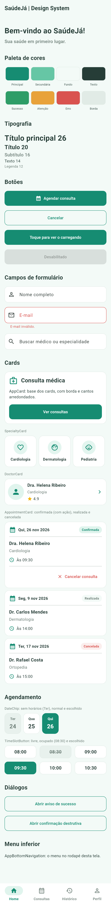

</details>

## API e mock do backend

- A documentação completa, com rotas, requests, responses e códigos de status, está em **[docs/API.md](docs/API.md)**.
- Os dados iniciais ficam em `assets/mock/*.json`. Agendar e cancelar funcionam durante o uso, e tudo volta ao estado inicial quando o app reinicia.
- O mesmo mock pode rodar como **servidor HTTP** (`http://localhost:8080`):

```powershell
dart run tool/mock_server.dart
```

- Com o servidor rodando, o app pode usá-lo **pela rede** em vez do mock interno:

```powershell
flutter run -d chrome --dart-define=API=http
```

No emulador Android, o computador fica em `10.0.2.2`:

```powershell
flutter run --dart-define=API=http --dart-define=API_URL=http://10.0.2.2:8080
```

**Usuário de teste:** `maria@saudeja.com` / `123456`

## Como rodar

Pré-requisito: Flutter (Dart 3.12 ou superior).

```powershell
flutter pub get
```

```powershell
flutter run
```

No navegador:

```powershell
flutter run -d chrome
```

Só o Sample App do design system:

```powershell
flutter run -t lib/main_design_system.dart
```

## Testes

```powershell
flutter analyze
```

```powershell
flutter test
```

São **120 testes**: 95 no app, com **cobertura de 91%**, e 25 no design system.

- **Regras do mock** e da API HTTP (requisições, erros, falta de rede, recuperação de senha).
- **ViewModels**: login, cadastro, esqueci minha senha, sessão salva, Home, detalhes do médico, agendamento, remarcação, consultas e histórico.
- **Fluxos completos nas telas**: do login até agendar, remarcar e cancelar; trocar a senha e entrar com a nova.
- **Acessibilidade** ([test/accessibility_test.dart](test/accessibility_test.dart)): diretrizes do Flutter (área de toque, botões com nome e contraste) nas telas principais, nos dois temas, e as telas com a fonte em 200% sem nada estourando. No pacote, um teste confere o contraste de todas as combinações de texto e fundo das duas paletas.
- **Testes visuais** dos componentes do design system, nos temas claro e escuro: cada um é comparado com uma imagem de referência em `packages/saude_ja_design_system/test/golden/goldens/`. Depois de mudar um componente de propósito:

```powershell
cd packages/saude_ja_design_system
```

```powershell
flutter test test/golden --update-goldens
```

Para ver a cobertura por pasta:

```powershell
flutter test --coverage
```

```powershell
dart run tool/coverage_summary.dart
```

A análise estática usa regras mais rígidas que o padrão do Flutter (tipagem estrita, `const`, aspas simples, ordem de imports, futures não aguardados), definidas em [analysis_options.yaml](analysis_options.yaml).

A cada push, o **GitHub Actions** ([.github/workflows/ci.yml](.github/workflows/ci.yml)) confere formatação, análise estática, os testes do app e do design system, cobertura mínima de 85% e o build web (no Linux) e roda os testes visuais num Windows, o mesmo sistema em que as imagens de referência foram geradas. O selo no topo deste README mostra o resultado, e a tabela de cobertura aparece no resumo de cada execução.

Os prints deste README são gerados por teste, sempre com os mesmos dados e data. Para atualizar depois de mudar alguma tela:

```powershell
flutter test screenshots/screenshots_test.dart --update-goldens
```

O ícone e a tela de abertura também são gerados a partir do design system
(imagens em `assets/brand/`):

```powershell
flutter test screenshots/brand_assets_test.dart --update-goldens
```

```powershell
dart run flutter_launcher_icons
```

```powershell
dart run flutter_native_splash:create
```

## Tecnologias

- Flutter e Dart
- `provider` (ChangeNotifier) para MVVM
- `shared_preferences` para salvar a sessão
- `http` para a API pela rede
- `flutter_localizations` para os textos do Flutter em português
- `flutter_launcher_icons` e `flutter_native_splash` para ícone e tela de abertura
- GitHub Actions para integração contínua
- Material 3

## Histórico de versões e licença

As mudanças de cada versão estão no [CHANGELOG](CHANGELOG.md).

Distribuído sob a [licença MIT](LICENSE).
